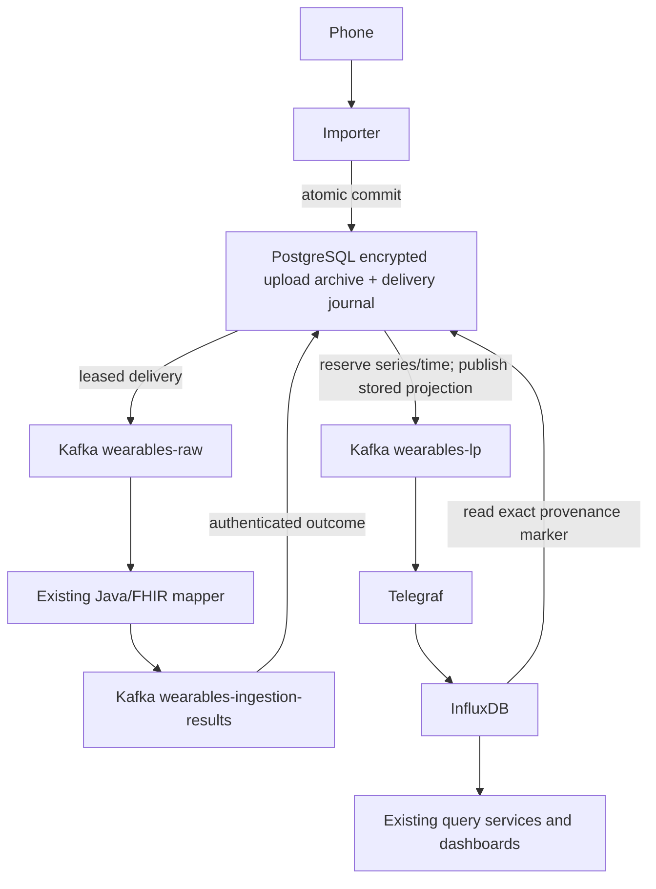

# Reliable ingestion

Branch: `reliable-ingestion`. Parent: `accounts-and-permissions` at `a02a1b6`.
Review the diff against that parent. No dashboard, account workflow, mobile
collector, export format, metric inventory or clinical access policy is replaced.

## Scope and flow

This feature adds five things: truthful upload receipts; separate participant
and source identities; immutable source-record identity where supplied; links
from stored points to input and processing version; and recovery from retained
input. The existing Kafka, Java/FHIR, Telegraf and InfluxDB components remain.

The result topic is a deliberate extra step. The journal records the outcome
and reserves the final series/timestamp before forwarding line protocol.
Otherwise InfluxDB can merge different source records at the same point.
Historical raw Kafka records still use the original mapper-to-LP path. They do
not acquire an archive receipt or verified provenance retroactively.

## Upload API

`POST /ingest` keeps the existing numeric batch shape. It returns **202 only
after the archive, record links and delivery jobs commit in PostgreSQL**.
The current Flutter uploader accepts any 2xx response. Preserve the same request
bytes and optional `Idempotency-Key` when retrying an uncertain HTTP result.

`status: archived` is the acceptance guarantee, not a claim that processing is
finished. `processingState` summarizes progress separately. Counts distinguish broker confirmation, normalization, rejection,
observed storage, blocked delivery and conflicting processing results.
`total_messages_produced` now counts actual broker-confirmed record messages;
it is not pre-filled with a batch count. Original category counts remain in the
POST response for compatibility.

`GET /ingest/{acceptanceId}` returns progress. `POST /ingest/{acceptanceId}/retry`
can restart failed work. Both require a valid, unexpired case-verification JWT
with the same case **and** participant as the upload; other scopes receive 404.
The original upload cannot be edited. A rejected record can be retried up to
four times with a new processing generation. Successful results are not
overwritten by that route. Expired credentials must be renewed through the
existing enrollment flow; this feature does not grant new clinical authority.

Limits: 500,000 raw bytes by default (configurable up to 700,000), 1,000 readings
by default, ten seconds to receive a body, bounded concurrent admissions and
database pools. Admission also limits each case/participant to 1,000 new uploads
and 50 MB of original input per hour. Repeated identical requests reuse their
receipt. Changed bytes with the same explicit key return 409.

## Identity and compatibility

The optional new profile is `contractVersion: "wearables-numeric/1"`. It requires
`sourcePlatform`, a stable provider namespace `sourceId`, and `sourceRecordId`
on every reading. Provider record identity is scoped to case and participant.
Repeated records reuse their immutable result, even if the delivery time or
phone installation changes. Reusing an identity with changed measurement data
returns 409 and rolls back the entire batch. A correction/deletion contract is
outside this feature; do not overwrite accepted source records.

The profile supports the three existing numeric categories: instantaneous,
cumulative and duration. Values are finite binary64 numbers; timestamps require
an explicit offset and at most six fractional digits. Higher-precision or
structured signals require another contract. This is not a claim of new provider
or metric support. Source/device identifiers are declared by an authenticated
uploader; they are not hardware attestation.

Unversioned clients remain accepted and are labelled `upload-only` identity.
Exact request retries are recognized, but readings in different legacy uploads
cannot be reliably deduplicated without source IDs. Their existing assumption
that timezone-free times mean UTC remains a compatibility limitation; the new
profile rejects such ambiguous times.

`deviceInfo.deviceId` retains the sender/device information. The server supplies
separate `participantId` and `caseId` from the token. FHIR `subject.reference`
uses the participant; `device.display` uses the supplied device information.
The LP tag `source-device-id` carries the latter. The existing Telegraf rule
provides the legacy `device-id` participant tag used by dashboards. Historical
Kafka payloads that already conflated these identities cannot recover the
original physical device ID.

## Provenance and failures

Original HTTP bytes have SHA-256 checksums and AES-256-GCM encryption with
row-bound authenticated context. Normalization inputs and retained projections
are encrypted too. Embedded payload authorization tokens are not forwarded to
Kafka; the exact original remains in the protected archive. There is no public
raw-archive download route. Do not log raw bodies or pipeline payloads.

Signed input and result envelopes use domain-separated HMAC-SHA256. The archive
key is separate and is not shared with the mapper. Stored points contain record
and upload IDs, original-input checksum, input fingerprint, mapper version and
output fingerprint as **fields**. One source hash is a tag; there is no per-record
ID tag. Different records competing for a final series/time are quarantined
instead of overwriting one another. A conflicting second mapper result is
visible for review and cannot replace the first result.

The mapper version fingerprints the active YAML and running artifact. Receipt-
backed records receive FHIR validation on every attempt. The old validator caught
its own failures; that bug is fixed. Historical direct-Kafka traffic retains its
configured validation sampling. Validation is structural/profile validation,
not clinical approval or a proof of sensor accuracy.

Multiple importer processes claim jobs with PostgreSQL row locks and leases.
They wait for Kafka delivery callbacks before recording broker confirmation.
Lost acknowledgements can cause replay; retained identities and projection
ownership make those replays safe. Result offsets are committed only after
the database transaction; a database failure cannot skip a result by committing
a later offset. Old lease holders and old processing generations are fenced.
Delayed normalization and unobserved projections are replayed with bounded
attempts; exhausted jobs stay blocked with their archive intact.

Storage confirmation is a separate read of the exact output fingerprint from
InfluxDB, not a claim derived from Kafka publication. Observation is scheduled
fairly across pending records. A positive observation proves that point was
present at that time; it does not promise permanent availability after retention
or deletion. PostgreSQL, Kafka and InfluxDB still need correct durability,
backup and retention configuration. Independent disaster-restore authority,
successful-result reprocessing and clinical correction histories are separate
future work.

## Runtime setup

Use a dedicated database/role or the `ingestion` schema in an existing PostgreSQL
instance. This does not put account data into InfluxDB or expose archive tables
through db_lord REST/GraphQL. Apply `python -m app.migrate` once using a migration
role, with `INGEST_DATABASE_URL` set. Never use that role for ordinary runtime.
Runtime needs SELECT/INSERT on uploads and links; SELECT/INSERT/UPDATE on records
and outbox; INSERT on events; and sequence usage. It needs no archive UPDATE or
DELETE privilege. Review retention and role ownership with the operators.

Required importer settings: `INGEST_DATABASE_URL`, a strong `JWT_SECRET`,
`JWT_ISSUER`, and distinct base64-encoded 32-byte `INGEST_ARCHIVE_KEY` and
`INGEST_SIGNING_KEY`. `INGEST_ARCHIVE_KEY_ID` identifies the current archive key;
`INGEST_ARCHIVE_OLD_KEYS` is a JSON map of old IDs to keys needed to read existing
rows. Back up these keys separately from the database. Startup rejects missing
keys; rotating a key does not rewrite old archives automatically.

Configure Kafka brokers and the three topics using `KAFKA_BOOTSTRAP_SERVERS`,
`KAFKA_TOPIC`, `KAFKA_RESULTS_TOPIC`, `KAFKA_OUTPUT_TOPIC`. Use a distinct
`KAFKA_RESULTS_GROUP` per journal database; replicas sharing one journal share
that group. The Python
`KAFKA_SECURITY_JSON` accepts transport and credential settings only. Configure
Kafka TLS and topic ACLs; envelope signatures do not replace transport security.
The mapper needs the same signing key, its existing broker/YAML settings, and
`RESULTS_TOPIC`. Its `KAFKA_SECURITY_PROPERTIES_JSON` accepts Java Kafka
TLS/SASL properties without allowing processing or hostname-verification
overrides. Configure `INFLUXDB_URL`, `INFLUXDB_ORG`, `INFLUXDB_BUCKET` and
`INFLUXDB_TOKEN` with bucket read permission for storage observation. Without
read access storage cannot be confirmed. Provision secrets outside Git.
Use PostgreSQL TLS for remote database connections. Signing-key changes require
a coordinated drain/cutover; dual signing-key verification is not implemented.

Rollout order: apply schema and least-privilege grants; provision result topic,
TLS/ACLs and secrets; update the mapper; update the importer; then verify one
synthetic upload through Telegraf and InfluxDB. Existing direct writers must not
write into the new provenance namespace. Replaying historical data across the
cutover needs an explicit migration plan; this is not a retroactive deduplication
of old InfluxDB series.

## Verification and change log

Run Python checks from `services/backend/importservice`: install `requirements.txt`
plus pytest, pytest-asyncio and Ruff; then `ruff check app tests` and `pytest -q`.
PostgreSQL tests require `INGEST_TEST_DATABASE_URL`. They refuse any database
whose name is not `ingestion_test`, then recreate its ingestion schema. Do not
run them concurrently against one database.

`tests/compose.yaml` provides isolated loopback test services. Supply randomly
generated `INGEST_TEST_DB_PASSWORD`, `INGEST_TEST_INFLUX_PASSWORD` and
`INGEST_TEST_INFLUX_TOKEN` in a private env file. Use a separate compose project.
This single-broker plaintext setup is only for synthetic local tests.

Package the mapper with `mvn package` **before** running the connected test.
Set `INGEST_TEST_STACK=1`, `INGEST_TEST_INFLUX_TOKEN` and `INGEST_TEST_LOG_DIR`;
then run `pytest -q tests/test_connected.py`. The test launches and stops its
Java process and verifies the full path, exact value/time, repeat delivery,
provenance, legacy dashboard identity tag, and a partially rejected batch.

Changes completed in this branch:

1. Bounded numeric contracts, separate identities, authenticated archive crypto.
2. Atomic PostgreSQL acceptance, immutable source records and leased delivery.
3. Signed mapper results, actual FHIR failure handling, versioned provenance and
   guarded projection delivery; current dashboard path retained.
4. Receipt/status/retry API, safe result replay and observed storage checks.
5. Regression and connected-stack checks completed locally on 2026-10-31:
   45 Python/API/PostgreSQL regression checks and one real connected-stack check,
   plus 12 Java tests (58 checks in total). Ruff and packaging also pass.
   The connected check is counted once; it is deliberately skipped during the
   separate regression-only run. One existing Starlette/AnyIO test deprecation
   warning remains. No physical-device or cloud deployment test was performed.

The connected run verified the stored binary64 value and UTC timestamp, one
point after repeat delivery, the original upload hash, separate participant and
sender tags, and an upload with one stored reading and one explicit rejection.
The category contract test covers all three numeric input shapes; this does not
claim clinical mapping acceptance for every metric in those shapes.

Local test resources are isolated from the account and main UI demos. No push,
main change or dashboard replacement is part of this feature. The old
unacknowledged background producer is removed; the bounded delivery worker
replaces it. Existing clinical/unit mapping coverage, multi-device quality
selection, new mobile collection features and institution production approval
remain outside this branch.

Maven now pins JUnit versions and enables the Vintage engine so the existing
JUnit 4 tests actually run. The previous discovery configuration ran zero tests.
The obsolete graph-test fixture is replaced with assertions against the active
mapping, and Maven no longer rewrites a tracked generated POM while packaging.

The callback/offset behavior follows the [Confluent Python client documentation](https://docs.confluent.io/kafka-clients/python/current/overview.html).
Database pooling follows [Psycopg documentation](https://www.psycopg.org/psycopg3/docs/advanced/pool.html).
The bridge remains the [Telegraf Kafka consumer](https://docs.influxdata.com/telegraf/v1/input-plugins/kafka_consumer/).
