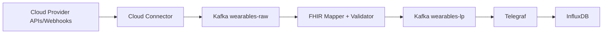

# Cloud Connector

Ingests health data from external wearable cloud APIs (OAuth 2.0 linking, token refresh, webhooks and REST sync) and publishes standardized `IngestPayload` messages to Kafka (`wearables-raw`).

Swagger/ReDoc: `/docs` and `/redoc` locally, or `/cloud/docs` and `/cloud/redoc` behind Traefik (`ENABLE_DOCS=true`).

## Data Flow

## Sections

- **[Providers & Limits](providers.md):** Supported cloud providers, docs, testing limits and production requirements
- **[API Endpoints](api.md):** Public endpoints, cluster-internal admin routes and example sync request
- **[Configuration & Dev](configuration.md):** Environment variables, local development and webhook testing
