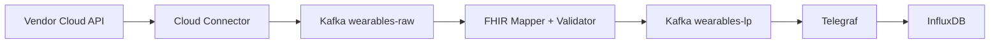

# Wearables Cloud Connector Service

A modular ingestion microservice for external wearable cloud APIs in the **Wearables** platform.

## Overview

Although mobile aggregators (Android Health Connect and Apple HealthKit) support a wide range of health metrics, some vendors (such as Garmin) do not forward all recorded parameters to them and only expose those via their own cloud APIs. The **Cloud Connector Service** fetches this data directly from vendor clouds and pushes it into the **Wearables** ingestion pipeline. It also feteches possible more data than mobile aggregators can provide.

## Data Flow



## Structure

Providers are registered in `app/providers/`:

1. **`BaseCloudProvider` (`app/providers/base.py`):**
   Base interface (`provider_name`, `validate_credentials`, `fetch_telemetry`) implemented by each vendor integration.
2. **Provider Registry (`app/providers/__init__.py`):**
   Maps provider keys to their implementation. Adding another vendor only requires subclassing `BaseCloudProvider` and registering its key in `_PROVIDERS`.
3. **Payload Format (`app/models.py`):**
   Responses are mapped into the standard `IngestPayload` categories before being published to `wearables-raw`:
   - **`instantaneous`:** Point-in-time vital signs and biomarkers (`HEART_RATE`, `RESTING_HEART_RATE`, `BLOOD_OXYGEN`, `RESPIRATORY_RATE`, `HEART_RATE_VARIABILITY_RMSSD`, `STRESS_LEVEL`, `BODY_BATTERY`, `BLOOD_PRESSURE_SYSTOLIC`, `BLOOD_PRESSURE_DIASTOLIC`, `BODY_TEMPERATURE`, `WEIGHT`, `BODY_MASS_INDEX`, `BODY_FAT_PERCENTAGE`, `VO2_MAX`, `ELECTROCARDIOGRAM`).
   - **`cumulative`:** Aggregated activity counters (`STEPS`, `FLIGHTS_CLIMBED`, `ACTIVE_ENERGY_BURNED`, `BASAL_ENERGY_BURNED`, `DISTANCE_WALKING_RUNNING`).
   - **`duration`:** Time-span intervals and sleep stages (`SLEEP_ASLEEP`, `SLEEP_DEEP`, `SLEEP_LIGHT`, `SLEEP_REM`, `SLEEP_AWAKE`, `EXERCISE_TIME`).
   - **`waveforms`:** High-frequency sensor recordings of arbitrary duration (e.g. 30s, 60s, or multi-minute `ELECTROCARDIOGRAM` (ECG) recordings, including `durationSeconds`, sampling frequency in Hz, rhythm classification, lead information, and raw microvolt sample arrays).

## Currently Implemented Providers

| Provider Key | Ecosystem | Status | Supported Authentication |
|---|---|---|---|
| `garmin` | Garmin Connect | Implemented | OAuth 2.0 PKCE (`GARMIN_CLIENT_ID` / `GARMIN_CLIENT_SECRET`), PUSH Webhooks & Bearer Token |

## API Endpoints

| Method | Endpoint | Description |
|---|---|---|
| `GET` | `/health` | Service health check |
| `GET` | `/providers` | List all registered cloud providers |
| `GET` | `/auth/{provider_name}/login?patient_id=...` | Initiates OAuth 2.0 PKCE login and redirects user to the vendor consent page |
| `GET` | `/callback` | OAuth 2.0 PKCE callback: exchanges code for tokens, fetches vendor `userId`, and links `patient_id` |
| `GET` | `/connections` | Lists linked patient accounts and granted permissions |
| `POST` | `/connections/{provider_name}/{patient_id}/refresh` | Refreshes an OAuth 2.0 access token using the stored `refresh_token` |
| `DELETE` | `/connections/{provider_name}/{patient_id}` | Deregisters the user at the vendor and deletes the local link |
| `POST` | `/webhooks/{provider_name}` | Receives PUSH webhook notifications, maps vendor `userId` to `patient_id`, and publishes to Kafka |
| `POST` | `/sync/{provider_name}` | Triggers telemetry fetch & Kafka publication for a patient |

## Example Sync Request

```json
POST /sync/{provider_name}
{
  "patient_id": "01a17e07-a10d-7a7c-aa23-2a0da2297b39",
  "credentials": {
    "token": "PROVIDER_ACCESS_TOKEN"
  }
}
```


